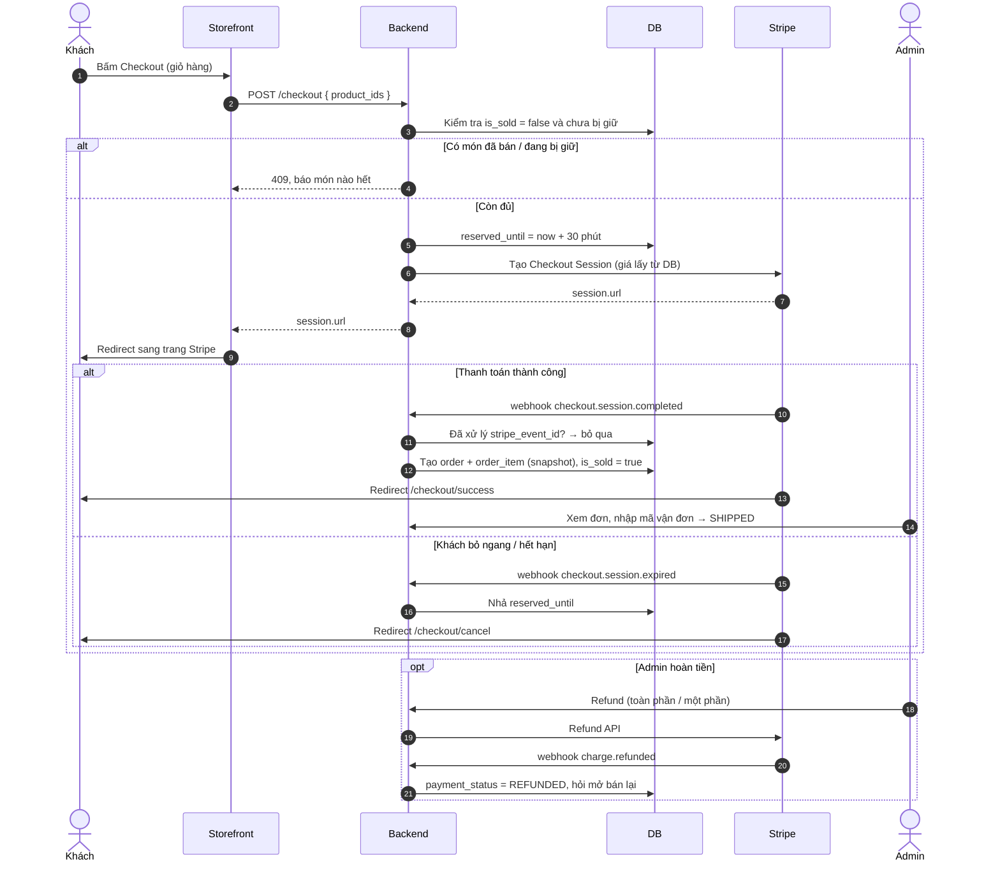
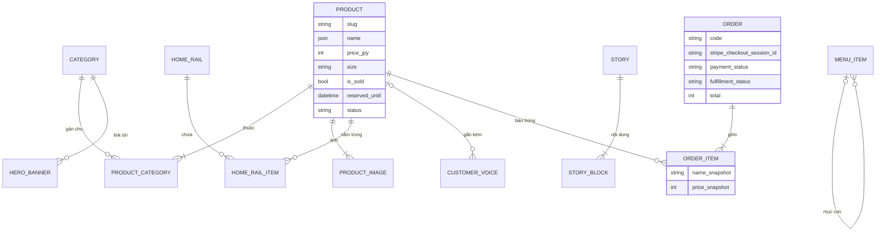

# Admin Amb:STORAGE – Đặc tả màn hình

Cập nhật: 2026-10-21 · Dựa trên storefront `amp-web` hiện tại (Next.js, ja/en).

Đầu vào cho bước thiết kế DB → backend API. Admin là app riêng; storefront đọc dữ liệu qua `StorefrontRepository` (`lib/storefront/repository.ts`).

**Nguyên tắc:** hàng vintage mỗi món chỉ có 1 cái. Không có biến thể, không có tồn kho. Ngoài **Category**, mọi thông tin sản phẩm (giá, size, condition…) admin nhập thẳng trên sản phẩm, không cần bảng danh mục riêng.

---

## 0. Quy ước

| Ký hiệu | Ý nghĩa |
| --- | --- |
| **(ja/en)** | Nhập cả tiếng Nhật và tiếng Anh (2 tab trong form) |
| **(EN)** | Một ô tiếng Anh, hiện giống nhau ở cả 2 ngôn ngữ |
| **\*** | Bắt buộc |
| `position` | Thứ tự kéo thả |

- Bảng nào cũng có `id`, `created_at`, `updated_at`.
- Sản phẩm và bài blog có `status`: `DRAFT` / `PUBLISHED`. Storefront chỉ đọc `PUBLISHED`.
- `slug` duy nhất, chỉ gồm `a-z 0-9 -`.

---

## 1. Cây màn hình

```
Admin
├── 1. Đăng nhập
├── 2. Sản phẩm                → /shop, /shop/[slug]
│   ├── 2.1 Danh sách
│   └── 2.2 Thêm / sửa
├── 3. Category                → bộ lọc /shop, Hero trang chủ
├── 4. Trang chủ               → /
│   ├── 4.1 Hero banner
│   ├── 4.2 Special Vintage / New Arrivals / Most Popular
│   └── 4.3 Customer Voice
├── 5. Blog Mili Talks         → /blog, /blog/[slug]
├── 6. Đơn hàng (Stripe)       ← webhook Stripe Checkout
│   ├── 6.1 Danh sách đơn
│   └── 6.2 Chi tiết đơn
└── 7. Cài đặt web
    ├── 7.1 Header (menu)
    ├── 7.2 Footer
    ├── 7.3 About
    ├── 7.4 Policy
    └── 7.5 Thông tin cửa hàng & SEO
```

---

## 2. Sản phẩm

### 2.1 Danh sách
- **Cột:** ảnh đầu, tên, các category (dạng chip), size, giá, Còn hàng / Đã bán, status, ngày đăng.
- **Tìm** theo tên. **Lọc** theo category, Còn hàng / Đã bán, status.
- **Trên từng dòng:** sửa, nhân bản, xoá, **bật/tắt Đã bán ngay trên dòng**.

### 2.2 Thêm / sửa

| Trường | Kiểu | Ghi chú | → Storefront |
| --- | --- | --- | --- |
| name \* | text (ja/en) | | Tiêu đề, card |
| slug \* | text | tự sinh từ name en | `/shop/<slug>` |
| categories \* | chọn nhiều từ màn 3 (tick), ≥ 1 | ví dụ Vintage MILITARY + Jackets | Hiện ở mọi bộ lọc / mục menu của các category đã chọn |
| price \* | số nguyên, JPY | > 0 | Giá (đã gồm thuế), lọc giá |
| size \* | text tự do | gợi ý từ các size đã nhập (`36`, `M`…) | Dòng size, bộ lọc Size |
| condition | text (ja/en) | ví dụ `USED（中古）`, `GOOD USED` | Khối Condition |
| description \* | text nhiều dòng (ja/en) | | Khối Product Details |
| images \* | nhiều ảnh, kéo thả thứ tự | ảnh 1 là ảnh card | Slider + lưới ảnh |
| is_sold \* | bool | mặc định false | Hiện SOLD thay cho giá, khoá nút giỏ hàng |
| published_at \* | datetime | mặc định lúc đăng | Sắp xếp Newest, New Arrivals |
| status \* | `DRAFT` / `PUBLISHED` | | |

- Lưu nháp được khi còn thiếu trường; chỉ kiểm tra đủ khi chuyển `PUBLISHED`.
- Xoá sản phẩm đang nằm trong mục 4.2 / 4.3 → cảnh báo, xoá xong tự gỡ khỏi các danh sách đó.

---

## 3. Category
Bảng sửa trực tiếp trên dòng, kéo thả thứ tự.

| Trường | Ghi chú |
| --- | --- |
| slug \* | dùng cho `/shop?category=<slug>` |
| name \* (ja/en) | |
| position | |

Hiện số sản phẩm ở mỗi dòng. Xoá category đang có sản phẩm → cảnh báo, gỡ category đó khỏi các sản phẩm; nếu sản phẩm nào chỉ còn đúng category này thì không cho xoá (sản phẩm phải có ≥ 1 category).

---

## 4. Trang chủ

### 4.1 Hero banner
- 2 ô cố định (hiện là VINTAGE MILITARY, VINTAGE DENIM).
- Mỗi ô: ảnh nền \*, category liên kết \* (link tới `/shop?category=`).

### 4.2 Special Vintage / New Arrivals / Most Popular
3 dải sản phẩm cố định, admin không thêm/xoá dải, chỉ chọn sản phẩm hiển thị.

- Mỗi dải: tìm và thêm sản phẩm, kéo thả thứ tự, gỡ. Một sản phẩm được nằm ở nhiều dải.
- **New Arrivals** có thêm lựa chọn **Tự động**: lấy N sản phẩm mới nhất theo `published_at` (đề xuất mặc định, đỡ phải cập nhật tay).
- Cảnh báo khi dải có sản phẩm Đã bán hoặc DRAFT.
- Tiêu đề dải cố định tiếng Anh, không có ô nhập.
- Browsing History lấy từ trình duyệt khách, không có trong admin.

### 4.3 Customer Voice

| Trường | Ghi chú |
| --- | --- |
| customer_name \* | ví dụ "大阪府のF様" |
| quote \* | 1 ngôn ngữ, giữ nguyên như khách viết |
| product | ảnh sản phẩm hiện kèm |
| is_visible, position | |

---

## 5. Blog Mili Talks

| Trường | Ghi chú |
| --- | --- |
| title \* (ja/en) | |
| slug \* | `/blog/<slug>` |
| published_at \* | kiểu ngày (mock hiện là chuỗi "2026年7月2日") |
| cover_image \* | |
| excerpt \* (ja/en) | card blog |
| status \* | `DRAFT` / `PUBLISHED` |

**Nội dung: block editor.** Danh sách block, thêm / xoá / kéo thả `position`. Khớp với `StoryContentSection` trong `lib/storefront/types.ts`.

| Loại block | Trường |
| --- | --- |
| `richText` | content_html \* (ja/en), tone `white` / `muted` |
| `imageText` | image \*, content_html \* (ja/en), reverse (ảnh trái/phải), tone |
| `contact` | title \* (ja/en), description \* (ja/en); form liên hệ bên dưới cố định |

- Toolbar rich text: Heading (h2), Bold, Link, Bullet list. Backend sanitize, chỉ giữ `h2 p strong a ul li`.
- Bài mock cũ chỉ có `contentHtml` → chuyển thành 1 block `richText`.

---

## 6. Đơn hàng (Stripe)

Khách thanh toán qua **Stripe Checkout**. Stripe là nơi giữ tiền và thông tin thẻ; DB chỉ lưu bản sao đơn để admin xử lý giao hàng.

**Luồng:**
1. Khách bấm Checkout → backend kiểm tra từng món còn `is_sold = false` → tạo Checkout Session (line items lấy giá từ DB, không tin giá từ client) với `metadata.product_ids`.
2. Webhook `checkout.session.completed` → tạo `order` + `order_item` (snapshot tên, giá, ảnh), đặt `is_sold = true` cho các sản phẩm.
3. Nếu lúc webhook về mà món đã bị bán (2 người mua cùng lúc) → tự refund qua Stripe API và đánh dấu đơn `REFUNDED`, admin thấy cảnh báo.
4. Webhook `charge.refunded` → cập nhật trạng thái đơn.
5. Xử lý webhook idempotent theo `stripe_event_id` (Stripe có thể gửi lặp).

Để tránh bán trùng, có thể giữ món trong lúc khách đang thanh toán: đặt `reserved_until` = hạn của session (30 phút), hết hạn hoặc `checkout.session.expired` thì nhả.



### 6.1 Danh sách đơn
- **Cột:** mã đơn, ngày, tên khách, số món, tổng tiền, trạng thái thanh toán, trạng thái giao hàng, trong nước / quốc tế.
- **Lọc:** trạng thái, khoảng ngày. **Tìm** theo mã đơn, email, tên.
- Huy hiệu số đơn chưa giao ở menu.

### 6.2 Chi tiết đơn
- Thông tin khách, email, SĐT, địa chỉ giao hàng (lấy từ Stripe `customer_details` / `shipping_details`).
- Danh sách món (snapshot), phí ship, thuế, tổng. Link mở đơn trên Stripe Dashboard.
- **Giao hàng:** `UNFULFILLED` → `SHIPPED` (nhập hãng vận chuyển + mã vận đơn, tuỳ chọn gửi email báo khách) → `DELIVERED`.
- **Hoàn tiền:** toàn phần hoặc một phần, gọi Stripe Refund API; hỏi có mở bán lại món không (`is_sold = false`).
- Ghi chú nội bộ.

| Trạng thái thanh toán | Nguồn |
| --- | --- |
| `PAID` | `checkout.session.completed` |
| `PARTIALLY_REFUNDED` / `REFUNDED` | `charge.refunded` hoặc admin bấm hoàn tiền |

---

## 7. Cài đặt web

### 7.1 Header (menu)
Một cây menu dùng chung cho header desktop và sidebar mobile, tối đa 2 cấp, kéo thả.

| Trường | Ghi chú |
| --- | --- |
| label \* (EN) | |
| link \* | chọn: trang cố định (Home, Shop, Blog, About, Policy), một category, hoặc URL |
| parent | mục cha |
| is_visible | |

Chọn category thì link tạo ra là `/shop?category=<slug>`. Menu Shop Now hiện trỏ tới `/shop/vintage-military`… nên đang ra 404.

### 7.2 Footer
- Link điều hướng: danh sách 1 cấp, cùng form với 7.1.
- Tagline (ja/en).
- Mạng xã hội: platform (Instagram / TikTok / Email…, dùng để chọn icon), URL, thứ tự, bật/tắt.
- Icon thanh toán: bật/tắt từng loại (Apple Pay, Google Pay, Visa, Mastercard, Amex, JCB…), nên khớp với phương thức đã bật trên Stripe.
- Copyright tự sinh theo năm.

### 7.3 About
- Bảng 会社概要: danh sách dòng {label, value} (ja/en), kéo thả.
- Các mục nội dung: {title, nội dung} (ja/en), kéo thả.

### 7.4 Policy
- Danh sách mục {title, nội dung rich text} (ja/en), kéo thả. Menu đầu trang tự sinh từ tiêu đề.
- Luật Nhật bắt buộc trang 特定商取引法 có: tên người bán, người phụ trách, địa chỉ, liên lạc, giá, phí phụ thu, thanh toán, giao hàng, đổi trả.

### 7.5 Thông tin cửa hàng & SEO
- Tên cửa hàng, email liên hệ, điện thoại, địa chỉ (ja/en), số 古物商許可証.
- Ghi chú thuế (ja/en): "表示価格はすべて税込です。".
- SEO mặc định: tiêu đề site, mô tả (ja/en), ảnh OG.

---

## 8. Entity cho DB

| Entity | Trường chính |
| --- | --- |
| admin_user | email, password_hash, name |
| category | slug, name (ja/en), position |
| product_category | product_id, category_id (khoá chính gồm cả 2) |
| product | slug, name (ja/en), price_jpy, size, condition (ja/en), description (ja/en), is_sold, reserved_until, published_at, status |
| product_image | product_id, url, position |
| home_rail | key (`special-vintage` / `new-arrivals` / `most-popular`), mode (`MANUAL` / `AUTO_NEWEST`), limit |
| home_rail_item | rail_key, product_id, position |
| hero_banner | position, image_url, category_id |
| customer_voice | customer_name, quote, product_id, is_visible, position |
| story | slug, title (ja/en), excerpt (ja/en), cover_image_url, published_at, status |
| story_block | story_id, type (`richText` / `imageText` / `contact`), position, tone, reverse, image_url, content_html (ja/en), title (ja/en), description (ja/en) |
| order | code, stripe_checkout_session_id, stripe_payment_intent_id, email, customer_name, phone, shipping_address (JSON), subtotal, shipping_fee, tax, total, currency, payment_status, fulfillment_status, carrier, tracking_no, note, paid_at |
| order_item | order_id, product_id, name_snapshot, price_snapshot, image_snapshot |
| stripe_event | stripe_event_id (unique), type, processed_at |
| menu_item | menu (`HEADER` / `FOOTER`), parent_id, label, link_type, link_target, is_visible, position |
| social_link | platform, url, is_visible, position |
| page_section | page (`ABOUT` / `POLICY`), title (ja/en), content (ja/en), position |
| setting | key, value (JSON): thông tin cửa hàng, ghi chú thuế, SEO, tagline, icon thanh toán |



Đứng riêng, không nối bảng nào: `admin_user`, `social_link`, `page_section`, `setting`, `stripe_event`. `menu_item.link_target` trỏ tới category / trang theo `link_type`, không phải khoá ngoại.

Bộ lọc Size ở `/shop` lấy bằng `SELECT DISTINCT size` từ sản phẩm đã đăng, không cần bảng riêng.

---

## 9. Frontend cần sửa theo docs này
- `Availability` (`AVAILABLE` / `LOW_STOCK` / `SOLD_OUT`) → `isSold: boolean`.
- Bỏ `tags` khỏi `Product` (chưa sản phẩm nào dùng).
- Bỏ `period` và `measurements` khỏi `Product`: bỏ bộ lọc Period ở `/shop` (`ShopCatalog`, `RefineDrawer`), bỏ dòng số đo trong khối Sizes (`ProductInfo`) và trong `AddToCartDialog`.
- `Product.category: "military" | "denim"` → `categories: string[]` (slug, do admin thêm). Bộ lọc `/shop?category=x` lấy sản phẩm có `x` trong `categories` (`lib/storefront/filters.ts`).
- Giỏ hàng: số lượng mỗi sản phẩm tối đa 1.
- Nút checkout gọi API tạo Stripe Checkout Session rồi redirect; thêm trang `/checkout/success` và `/checkout/cancel`.
- Header / footer / social / payment icon đọc từ API thay vì hard-code (`header-navigation.ts`, `Footer.tsx`).

## Ngoài phạm vi đợt này
Tài khoản khách (đăng nhập SMS), newsletter, inbox form liên hệ: storefront mới có UI, chưa có backend.
