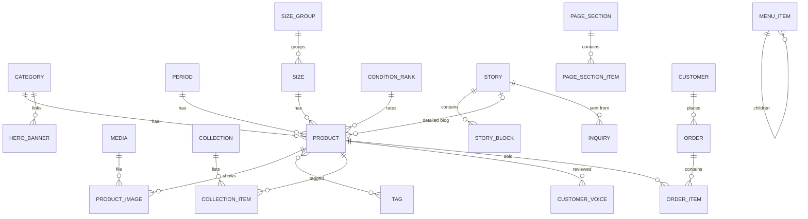

# Admin Amb:STORAGE – Đặc tả màn hình chức năng

Cập nhật: 2026-10-16 · Dựa trên storefront `amp-web` hiện tại (Next.js, ja/en).

File này là đầu vào cho bước **thiết kế DB → backend API**. Admin UI là một app React riêng, không nằm trong `amp-web`; storefront chỉ đọc dữ liệu qua interface `StorefrontRepository` (`lib/storefront/repository.ts`).

---

## 0. Quy ước

| Ký hiệu | Ý nghĩa | Gợi ý lưu DB |
| --- | --- | --- |
| **(ja/en)** | Nhập cả tiếng Nhật và tiếng Anh, form có 2 ô hoặc 2 tab | Cột `*_ja`, `*_en`, hoặc bảng `translations`, hoặc JSONB `{ ja, en }` |
| **(EN)** | Chỉ một ô tiếng Anh, hiện giống nhau ở cả 2 ngôn ngữ (yêu cầu của khách) | Một cột text |
| **\*** | Bắt buộc | `NOT NULL` |
| **→** | Dữ liệu hiện ra ở trang nào trên storefront | — |
| `position` | Thứ tự kéo thả | Cột int, sắp tăng dần |

Quy tắc chung cho mọi bảng:

- Có `id`, `created_at`, `updated_at`, `created_by`, `updated_by`.
- Nội dung có trạng thái `status`: `DRAFT` / `PUBLISHED`. Storefront chỉ đọc `PUBLISHED`.
- Xoá mềm (`deleted_at`) cho sản phẩm và bài viết để không gãy link cũ và lịch sử đơn.
- `slug` duy nhất trong từng loại, chỉ gồm `a-z 0-9 -`. Đổi slug thì lưu slug cũ để redirect 301.
- Mọi rich text (blog, trang tĩnh) được sanitize ở backend khi lưu, chỉ giữ các thẻ được phép (xem màn hình G-02).

---

## 1. Vai trò

| Vai trò | Quyền |
| --- | --- |
| Owner | Toàn quyền, kể cả quản lý tài khoản admin và Settings |
| Staff | Sản phẩm, trang chủ, blog, trả lời inquiry. Không xoá cứng, không vào Settings và tài khoản admin |

---

## 2. Cây màn hình

```
Admin
├── A. Tài khoản
│   ├── A-01 Đăng nhập
│   ├── A-02 Quên / đặt lại mật khẩu
│   └── A-03 Hồ sơ cá nhân, đổi mật khẩu
├── B-01 Dashboard
├── C. Sản phẩm                              → /shop, /shop/[slug], carousel trang chủ
│   ├── C-01 Danh sách sản phẩm
│   ├── C-02 Thêm / sửa sản phẩm
│   └── C-03 Xem trước trang chi tiết
├── D. Danh mục & giá trị lọc                → bộ lọc /shop, menu Shop Now
│   ├── D-01 Categories
│   ├── D-02 Periods
│   ├── D-03 Sizes (có nhóm size)
│   ├── D-04 Condition ranks
│   └── D-05 Tags
├── E. Trang chủ                             → /
│   ├── E-01 Collections (3 carousel)
│   ├── E-02 Customer Voice
│   ├── E-03 Hero banner
│   └── E-04 Khối Mili Talks trên trang chủ
├── F. Điều hướng                            → header, sidebar mobile, footer
│   ├── F-01 Menu header / sidebar mobile
│   ├── F-02 Footer
│   └── F-03 Mạng xã hội & icon thanh toán
├── G. Blog Mili Talks                       → /blog, /blog/[slug]
│   ├── G-01 Danh sách bài viết
│   ├── G-02 Thêm / sửa bài viết (block editor)
│   └── G-03 Cài đặt trang Blog (giới thiệu, nguồn tham khảo)
├── H. Trang tĩnh                            → /about, /policy
│   ├── H-01 About
│   └── H-02 Policy
├── I. Thư viện media
│   └── I-01 Thư viện ảnh
├── J. Cài đặt
│   ├── J-01 Thông tin cửa hàng
│   └── J-02 SEO mặc định
├── K. Bán hàng (giai đoạn 2, cần checkout + đăng nhập thật)
│   ├── K-01 Danh sách đơn hàng
│   ├── K-02 Chi tiết đơn hàng
│   ├── K-03 Khách hàng
│   ├── K-04 Newsletter
│   └── K-05 Inquiries (liên hệ)
└── L. Hệ thống
    ├── L-01 Tài khoản admin
    └── L-02 Nhật ký thay đổi
```

---

## 3. Chi tiết màn hình

### A. Tài khoản

#### A-01 Đăng nhập
- Email + mật khẩu. Khoá tạm 15 phút sau 5 lần sai liên tiếp.
- Ghi nhớ đăng nhập (refresh token).

#### A-02 Quên / đặt lại mật khẩu
- Nhập email → gửi link đặt lại, hết hạn sau 1 giờ, dùng một lần.

#### A-03 Hồ sơ cá nhân
- Sửa tên hiển thị; đổi mật khẩu (nhập mật khẩu cũ).

---

### B-01 Dashboard
- Thẻ số liệu: sản phẩm đang bán (AVAILABLE + LOW_STOCK), đã bán trong tháng (chuyển SOLD_OUT), số bản nháp, bài blog đã đăng, inquiry chưa trả lời.
- Giai đoạn 2: đơn mới, doanh thu tháng.
- Nút tắt: Thêm sản phẩm, Viết bài blog.
- 10 thay đổi gần nhất (lấy từ L-02).

---

### C. Sản phẩm

#### C-01 Danh sách sản phẩm
- **Cột:** ảnh 1, tên (ja), slug, category, period, size, giá, availability, status, ngày đăng, cập nhật lần cuối.
- **Tìm kiếm:** theo tên ja/en, slug.
- **Lọc:** category, period, size, availability, status, khoảng giá.
- **Sắp xếp:** mới nhất, giá, cập nhật lần cuối.
- **Hành động trên từng dòng:** sửa, nhân bản, xem trước, **chuyển nhanh SOLD_OUT ↔ AVAILABLE** (không cần mở form), xoá.
- **Hành động hàng loạt:** đổi availability, đổi status, xoá.
- Phân trang 50 dòng.

#### C-02 Thêm / sửa sản phẩm
Form chia theo đúng các khối của trang chi tiết storefront.

**Khối Cơ bản**

| Trường | Kiểu | Ràng buộc | → Storefront |
| --- | --- | --- | --- |
| name \* | text (ja/en) | ≤ 120 ký tự | Tiêu đề trang chi tiết, card, breadcrumb |
| slug \* | text | duy nhất; tự sinh từ name en | URL `/shop/<slug>` |
| price \* | int, JPY | > 0 | "¥110,000 (tax-in)", lọc giá min–max |
| category \* | chọn 1 từ D-01 | — | Bộ lọc Category |
| period \* | chọn 1 từ D-02 | — | Bộ lọc Period |
| size \* | chọn 1 từ D-03 | — | Dòng size dưới tên, "表記 / size", bộ lọc Size |
| availability \* | enum | `AVAILABLE` / `LOW_STOCK` / `SOLD_OUT`, mặc định AVAILABLE | SOLD_OUT: badge SOLD, khoá nút giỏ, ẩn khi tick In Stock |
| tags | chọn nhiều từ D-05 | — | Card chỉ hiện 2 tag đầu |
| published_at \* | datetime | mặc định lúc đăng | Sắp xếp Newest |
| status \* | enum | `DRAFT` / `PUBLISHED` | Chỉ PUBLISHED hiện ra |

**Khối Ảnh**

| Trường | Kiểu | Ràng buộc | → Storefront |
| --- | --- | --- | --- |
| images \* | nhiều ảnh từ I-01, có `position` | ≥ 1 ảnh, khuyến nghị ảnh vuông ≥ 1200px | Ảnh 1 = ảnh card + ảnh đầu slider; tất cả hiện ở lưới "商品画像一覧" |

Kéo thả để đổi thứ tự. Trang mẫu Acorn dùng khoảng 24 ảnh mỗi sản phẩm, nên cho upload nhiều ảnh cùng lúc.

**Khối Product Details**

| Trường | Kiểu | Ràng buộc | → Storefront |
| --- | --- | --- | --- |
| description \* | text nhiều dòng (ja/en) | — | Khối Product Details, giữ xuống dòng |

**Khối Sizes**

| Trường | Kiểu | Ràng buộc | → Storefront |
| --- | --- | --- | --- |
| measurements | text nhiều dòng (ja/en) | mỗi số đo một dòng, ví dụ `肩幅--46cm` | Khối Sizes, dưới dòng "表記 / size" |

Không nhập câu ghi chú sai số; storefront tự thêm.

**Khối Condition**

| Trường | Kiểu | Ràng buộc | → Storefront |
| --- | --- | --- | --- |
| condition_rank | chọn 1 từ D-04 | — | Chữ to ở khối Condition |

Câu ghi chú tiêu chuẩn đánh giá do storefront tự thêm.

**Khối Liên kết (chưa có trên storefront, trang mẫu Acorn có)**

| Trường | Kiểu | → Storefront |
| --- | --- | --- |
| related_story | chọn 1 bài từ G-01 | Mục "Detailed blog" |

**Khối SEO (tuỳ chọn)**: meta title, meta description (ja/en). Để trống thì dùng name/description.

**Quy tắc:**
- Lưu nháp được dù thiếu trường bắt buộc; chỉ kiểm tra đủ khi chuyển PUBLISHED.
- Đổi slug của sản phẩm đã đăng → tạo redirect từ slug cũ.
- Xoá sản phẩm: cảnh báo nếu nó đang nằm trong E-01 hoặc được E-02 trỏ tới; xoá xong thì gỡ khỏi các danh sách đó.
- Khi có đơn hàng (giai đoạn 2): đơn thành công tự chuyển sản phẩm sang SOLD_OUT.

#### C-03 Xem trước
- Mở trang chi tiết storefront với dữ liệu đang sửa (kể cả bản nháp), qua token xem trước.

---

### D. Danh mục & giá trị lọc

Mỗi màn hình là một bảng sửa trực tiếp trên dòng, kéo thả `position`. Không cho xoá giá trị đang được sản phẩm dùng; hiện số sản phẩm đang dùng ở mỗi dòng.

| Màn hình | Trường | → Storefront |
| --- | --- | --- |
| D-01 Categories | slug \*, name (ja/en) \*, ảnh (tuỳ chọn), position | Bộ lọc Category (in hoa), `?category=` cho menu Shop Now, Hero |
| D-02 Periods | value \* (ví dụ `1940s`), position | Bộ lọc Period |
| D-03 Sizes | value \* (ví dụ `36`, `M`), size_group (Outer/Tops, Bottoms, Shoes), position | Bộ lọc Size |
| D-04 Condition ranks | label (ja/en) \* (ví dụ USED, GOOD USED), position | Khối Condition |
| D-05 Tags | label (ja/en) \*, variant `default` / `accent` / `brand` | Badge trên card |

Hiện frontend cố định `category` chỉ là `military | denim`. Cho admin thêm category thì frontend phải đổi type sang string.

---

### E. Trang chủ

#### E-01 Collections
- 3 collection cố định: **Special Vintage**, **New Arrivals**, **Most Popular**. Admin không thêm hay xoá collection, chỉ sửa danh sách sản phẩm.
- Mỗi collection: tìm và thêm sản phẩm, kéo thả thứ tự, gỡ sản phẩm. Một sản phẩm được nằm ở nhiều collection.
- Cảnh báo khi trong collection có sản phẩm SOLD_OUT hoặc DRAFT.
- Tiêu đề section cố định tiếng Anh (yêu cầu của khách), không có ô nhập.
- Browsing History tự lấy từ trình duyệt khách, không có trong admin.

#### E-02 Customer Voice
- **Danh sách:** tên khách, câu trích dẫn (cắt ngắn), sản phẩm gắn kèm, hiện/ẩn, position.
- **Form:**

| Trường | Kiểu | Ràng buộc |
| --- | --- | --- |
| customer_name \* | text | ví dụ "大阪府のF様", "Texas, B.A様" |
| quote \* | text nhiều dòng, 1 ngôn ngữ | giữ nguyên ngôn ngữ khách viết |
| product | chọn 1 sản phẩm | ảnh sản phẩm hiện kèm câu trích |
| is_visible | bool | — |

#### E-03 Hero banner
- 2 ô category cố định thứ tự (VINTAGE MILITARY, VINTAGE DENIM).
- Mỗi ô: ảnh nền \* (I-01), category liên kết \* (D-01, quyết định link `/shop?category=`).
- Tiêu đề lấy từ tên category in hoa; nút "Shop Now" cố định tiếng Anh.

#### E-04 Khối Mili Talks trên trang chủ
- Bài nổi bật: chọn 1 bài từ G-01 (ảnh bìa, tiêu đề, phụ đề hiện ở khối này).
- Đoạn giới thiệu (ja/en).

---

### F. Điều hướng

#### F-01 Menu header / sidebar mobile
Dùng chung một cây cho header desktop và sidebar mobile.

- Cây 2 cấp, kéo thả để đổi thứ tự và đổi cấp.
- **Form một mục menu:**

| Trường | Kiểu | Ràng buộc |
| --- | --- | --- |
| label \* | text **(EN)** | hiện tiếng Anh ở cả ja và en |
| link_type \* | enum `PAGE` / `CATEGORY` / `STORY` / `PRODUCT` / `URL` | — |
| link_target | theo link_type: trang cố định (Home, Shop, About, Policy, Blog), id category, id bài viết, id sản phẩm, hoặc URL | URL ngoài mở tab mới |
| parent | mục cha | tối đa 2 cấp |
| is_visible | bool | — |

- Chọn link theo loại thì đổi slug vẫn không gãy link. Lỗi hiện tại: menu con của Shop Now trỏ tới `/shop/vintage-military`… (route chi tiết sản phẩm) nên ra 404; với `CATEGORY`, link đúng là `/shop?category=<slug>`.
- Tuỳ chọn cho mục Mili Talks: "tự lấy N bài mới nhất" thay vì chọn tay.

#### F-02 Footer
- **Link điều hướng:** danh sách 1 cấp, cùng form với F-01 (label **(EN)**, link_type, link_target), kéo thả.
- **Tagline** (ja/en).
- **Newsletter:** chữ placeholder, nút, thông báo cảm ơn (ja/en).
- Copyright tự sinh theo năm, không cần ô nhập.

#### F-03 Mạng xã hội & icon thanh toán
- **Mạng xã hội** (cũng dùng ở trang About): platform \* (enum `INSTAGRAM` / `TIKTOK` / `EMAIL` / …, dùng để chọn icon), URL \*, position, is_visible. Footer hiện đang lấy theo thứ tự mảng nên đổi thứ tự là sai icon; cần map theo platform.
- **Icon thanh toán:** bật/tắt từng loại: Apple Pay, Google Pay, Visa, Mastercard, Amex, Discover, JCB. Nên khớp với cổng thanh toán thật.

---

### G. Blog Mili Talks

#### G-01 Danh sách bài viết
- **Cột:** ảnh bìa, tiêu đề, slug, ngày đăng, status.
- **Tìm kiếm, lọc** theo status. **Hành động:** sửa, xem trước, nhân bản, xoá.

#### G-02 Thêm / sửa bài viết

**Thông tin bài**

| Trường | Kiểu | Ràng buộc | → Storefront |
| --- | --- | --- | --- |
| title \* | text (ja/en) | hiện chỉ 1 ngôn ngữ trong dữ liệu mẫu, đề xuất song ngữ | Tiêu đề, card blog, menu Mili Talks |
| slug \* | text | duy nhất | `/blog/<slug>` |
| published_at \* | date | dữ liệu mẫu đang là chuỗi "2026年7月2日", đề xuất đổi sang kiểu ngày | Ngày đăng, format theo locale |
| cover_image \* | ảnh từ I-01 | — | Card blog, đầu bài |
| excerpt \* | text (ja/en) | ≤ 200 ký tự | Card blog |
| status \* | `DRAFT` / `PUBLISHED` | — | — |
| SEO | meta title, description (ja/en) | tuỳ chọn | — |

**Nội dung: block editor**
Danh sách block có `position`, thêm / xoá / kéo thả.

| Loại block | Trường |
| --- | --- |
| `richText` | content_html (ja/en) \*, tone `white` / `muted` |
| `imageText` | image \* (I-01), content_html (ja/en) \*, reverse (ảnh trái/phải), tone |
| `contact` | title (ja/en) \*, description (ja/en) \*. Form liên hệ bên dưới cố định, gửi vào K-05 |

- Toolbar rich text chỉ gồm: **Heading (h2), Bold, Link, Bullet list**. Thẻ được phép: `h2 p strong a ul li`. Link nội bộ dùng chọn bài viết / sản phẩm.
- Dữ liệu mẫu có bài chỉ có `contentHtml`, có bài dùng `contentSections`. Khi chuyển dữ liệu, bài cũ thành 1 block `richText`.

#### G-03 Cài đặt trang Blog
- Tiêu đề trang (EN, hiện "MILI TALKS"), đoạn giới thiệu (ja/en).
- **Nguồn tham khảo:** đoạn mở đầu (ja/en) + các nhóm (Special Thanks, Brand / Shop, Collector). Mỗi nhóm: tên nhóm (ja/en), danh sách tên (text), position.

---

### H. Trang tĩnh
Hai trang dùng chung header "ABOUT US" và 2 tab (Commercial Transactions | Privacy Policy).

#### H-01 About

| Phần | Trường |
| --- | --- |
| 会社概要 | Danh sách dòng {label (ja/en), value (ja/en, nhiều dòng)}, kéo thả. Hiện thành bảng 2 cột. Hiện có: 社名, 代表社員, 店舗, 事業内容, 問い合わせ先, 古物商許可証 |
| Các mục văn bản | Danh sách mục {title (ja/en), các đoạn văn (ja/en)}: Brand Philosophy, Mission, Vision, Our Promise, Knowledge & Community, お問い合わせ |
| Core Values | Danh sách đánh số {title (ja/en), description (ja/en)} |

#### H-02 Policy
- Danh sách mục, kéo thả. Mỗi mục: anchor id (tự sinh), title (ja/en), và các thành phần (ja/en): đoạn văn, danh sách gạch đầu dòng, mục con {title, đoạn văn, gạch đầu dòng}, ghi chú (※).
- Menu đầu trang tự sinh từ tiêu đề các mục.
- Hiện có: 特定商取引法に基づく表記 / ご利用ガイド, 商品価格以外の必要料金, お支払い方法, 配送, 返品・交換, ヴィンテージ商品の特性, プライバシーポリシー.
- Pháp luật Nhật bắt buộc trang 特定商取引法 phải có: tên người bán, người phụ trách, địa chỉ, liên lạc, giá, phí phụ thu, thanh toán, giao hàng, đổi trả.

---

### I-01 Thư viện ảnh
- Upload nhiều file (jpg, png, webp; ≤ 10 MB/ảnh), tự tạo các cỡ thumbnail.
- **Lưới ảnh:** tìm theo tên file, lọc theo "đang dùng ở đâu" (sản phẩm, blog, hero…).
- **Chi tiết ảnh:** alt text (ja/en), kích thước, danh sách nơi đang dùng. Không cho xoá ảnh đang được dùng.
- Các màn hình khác chọn ảnh qua popup của thư viện này, hoặc upload thẳng.

---

### J. Cài đặt

#### J-01 Thông tin cửa hàng

| Trường | Kiểu | → Storefront |
| --- | --- | --- |
| store_name \* | text | Logo alt, tiêu đề |
| contact_email \* | email | Footer, About, Policy |
| phone | text | About, Policy |
| address | text (ja/en) | Policy (所在地) |
| tax_note | text (ja/en) | "※表示価格はすべて税込です。" ở đầu trang shop |
| antique_dealer_license | text | About (古物商許可証) |
| shipping_returns | block heading / list / paragraph / divider (ja/en) | Hiện **không hiển thị** ở đâu (đã bỏ khỏi trang chi tiết sản phẩm). Giữ lại nếu muốn đưa vào Policy |

#### J-02 SEO mặc định
- Tiêu đề site, mô tả (ja/en). Hiện là "AMB Vintage" và mô tả trong `messages/*.json` (namespace `metadata`).
- Ảnh chia sẻ mạng xã hội mặc định (OG image).

---

### K. Bán hàng (giai đoạn 2)
Storefront hiện chỉ có UI: giỏ hàng lưu localStorage, nút checkout chưa nối, đăng nhập bằng số điện thoại chưa có backend, form newsletter và form contact chưa lưu.

#### K-01 Danh sách đơn hàng
- **Cột:** mã đơn, ngày, khách, số món, tổng tiền, trạng thái thanh toán, trạng thái giao hàng, quốc gia.
- **Lọc:** trạng thái, khoảng ngày, trong nước / quốc tế.

#### K-02 Chi tiết đơn hàng
- Thông tin khách và địa chỉ giao hàng, danh sách món (snapshot tên, giá, ảnh tại lúc mua), phí ship, thuế/phí nhập khẩu (quốc tế), tổng.
- Đổi trạng thái: `PENDING` → `PAID` → `SHIPPED` → `DELIVERED`; hoặc `CANCELLED` / `REFUNDED`.
- Nhập mã vận đơn và hãng vận chuyển; ghi chú nội bộ.
- Đơn chuyển `PAID` → các sản phẩm trong đơn tự sang SOLD_OUT. Huỷ đơn → hỏi có mở bán lại không.

#### K-03 Khách hàng
- Danh sách: tên, số điện thoại (đăng nhập bằng SMS), email, số đơn, tổng chi.
- Chi tiết: địa chỉ đã lưu, lịch sử đơn.

#### K-04 Newsletter
- Danh sách email đăng ký, ngày đăng ký, trạng thái (đang nhận / đã huỷ). Xuất CSV.

#### K-05 Inquiries
- Tin nhắn từ form contact trong blog: họ tên, email, tiêu đề, nội dung, bài viết gửi từ đó, ngày gửi.
- Trạng thái `NEW` / `REPLIED` / `CLOSED`, ghi chú nội bộ.

---

### L. Hệ thống

#### L-01 Tài khoản admin (chỉ Owner)
- Danh sách: tên, email, vai trò, lần đăng nhập cuối, hoạt động / khoá.
- Mời qua email, đổi vai trò, khoá tài khoản.

#### L-02 Nhật ký thay đổi
- Ai, lúc nào, thao tác gì (tạo / sửa / xoá / đổi trạng thái), trên đối tượng nào; xem giá trị trước và sau.

---

## 4. Danh sách entity cho thiết kế DB

| Entity | Trường chính | Quan hệ |
| --- | --- | --- |
| admin_user | email, password_hash, name, role, is_active, last_login_at | — |
| media | file_key, mime, width, height, size, alt (ja/en) | dùng bởi nhiều entity |
| category | slug, name (ja/en), image_id, position | 1–n product |
| period | value, position | 1–n product |
| size_group | name, position | 1–n size |
| size | value, size_group_id, position | 1–n product |
| condition_rank | label (ja/en), position | 1–n product |
| tag | label (ja/en), variant | n–n product |
| product | slug, name (ja/en), price_jpy, category_id, period_id, size_id, condition_rank_id, availability, description (ja/en), measurements (ja/en), related_story_id, published_at, status, seo (ja/en), deleted_at | n–n tag, 1–n product_image |
| product_image | product_id, media_id, position | — |
| slug_redirect | entity_type, old_slug, entity_id | — |
| collection | key (`special-vintage` / `new-arrivals` / `most-popular`), name (ja/en) | n–n product qua collection_item |
| collection_item | collection_id, product_id, position | — |
| customer_voice | customer_name, quote, product_id, is_visible, position | n–1 product |
| hero_banner | position, media_id, category_id | — |
| story | slug, title (ja/en), excerpt (ja/en), cover_media_id, published_at, status, seo, deleted_at | 1–n story_block |
| story_block | story_id, type, position, tone, reverse, media_id, content_html (ja/en), title (ja/en), description (ja/en) | — |
| blog_reference_group | name (ja/en), items (text[]), position | — |
| menu_item | menu (`HEADER` / `FOOTER`), parent_id, label_en, link_type, link_target, is_visible, position | tự tham chiếu (parent) |
| social_link | platform, url, is_visible, position | — |
| payment_icon | type, is_enabled | — |
| page_section | page (`ABOUT` / `POLICY`), anchor, title (ja/en), position | 1–n page_section_item |
| page_section_item | section_id, type (`paragraph` / `bullets` / `detail` / `note` / `label_value`), position, content (ja/en, JSON) | — |
| setting | key, value (JSON) | store info, tax note, SEO, newsletter text, blog intro… |
| audit_log | admin_user_id, action, entity_type, entity_id, before, after, created_at | — |
| *Giai đoạn 2* customer | phone, email, name | 1–n order, address |
| *Giai đoạn 2* order | code, customer_id, status, payment_status, shipping (JSON), subtotal, shipping_fee, total, tracking_no | 1–n order_item |
| *Giai đoạn 2* order_item | order_id, product_id, snapshot (name, price, image) | — |
| *Giai đoạn 2* newsletter_subscriber | email, status, subscribed_at | — |
| *Giai đoạn 2* inquiry | name, email, title, message, story_id, status, note | — |



---

## 5. API storefront cần có
Khớp với `StorefrontRepository` hiện tại để frontend gần như không phải sửa. Tất cả chỉ trả dữ liệu `PUBLISHED`.

| Hàm hiện tại | Endpoint gợi ý | Ghi chú |
| --- | --- | --- |
| `getProducts(query)` | `GET /products` | Tham số: search, category, period, size, priceMin, priceMax, inStock, sort (`newest` / `price-low` / `price-high`) |
| `getProductBySlug(slug)` | `GET /products/:slug` | Kèm ảnh theo position, condition, measurements |
| `getHomepage()` | `GET /homepage` | 3 collection (id sản phẩm theo thứ tự) + customer voices |
| `getCategories()` / `getCollections()` | `GET /categories`, `GET /collections` | — |
| `getStories()` / `getStoryBySlug()` | `GET /stories`, `GET /stories/:slug` | Kèm block theo position |
| `getStoreSettings()` | `GET /settings` | Store info, tax note, social, shipping/returns |
| *(mới)* | `GET /navigation` | Menu header + footer + payment icons |
| *(mới)* | `GET /filters` | Danh sách period, size, condition để dựng bộ lọc |
| *(mới)* | `GET /pages/:page` | About, Policy |
| *(mới)* | `POST /newsletter`, `POST /inquiries` | Form footer và form contact blog |

API cho admin: CRUD cho từng entity ở mục 4, thêm `PATCH /products/:id/availability`, `PUT /collections/:key/items` (thay cả danh sách + thứ tự), `PUT /menus/:menu` (thay cả cây), upload media, và preview token.

---

## 6. Cần chốt trước khi thiết kế DB

- [ ] **Tồn kho:** giỏ hàng hiện cho tăng số lượng, nhưng hàng vintage chỉ có 1 cái. Chọn giữ `availability` (enum) hay thêm `stock_qty` (mặc định 1, hết thì tự SOLD_OUT)?
- [ ] **Bộ lọc chọn nhiều:** Acorn cho tick nhiều Period; hiện mỗi nhóm chỉ chọn 1. Nếu cần chọn nhiều, API phải nhận mảng.
- [ ] **Category động:** cho admin thêm category mới không (frontend đổi type `Product.category` sang string)?
- [ ] **Blog:** đổi `title` sang song ngữ và `date` sang kiểu ngày?
- [ ] **Lưu bản dịch:** cột `_ja`/`_en`, bảng translations, hay JSONB?
- [ ] **Shipping & Returns:** bỏ hẳn hay chuyển sang trang Policy?
- [ ] **Giai đoạn 2 (mục K)** có làm cùng đợt này không?
